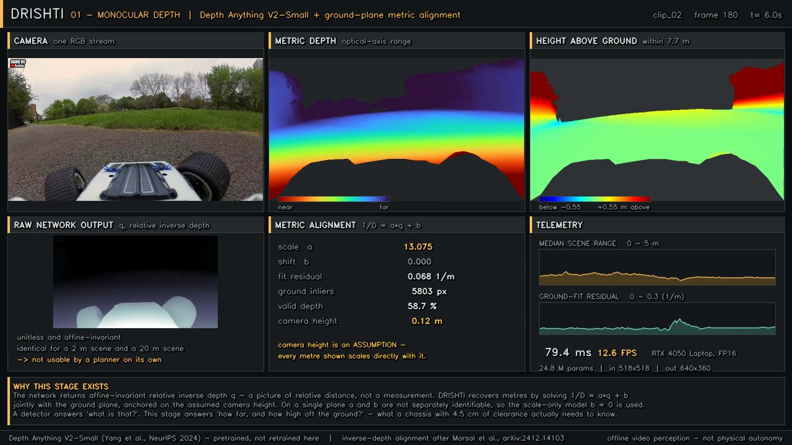
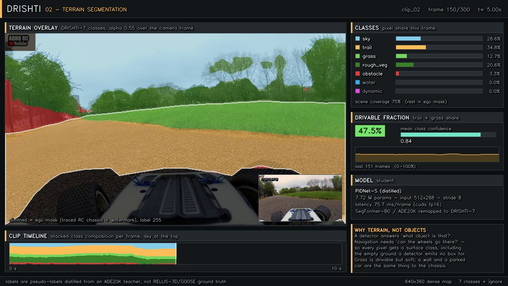
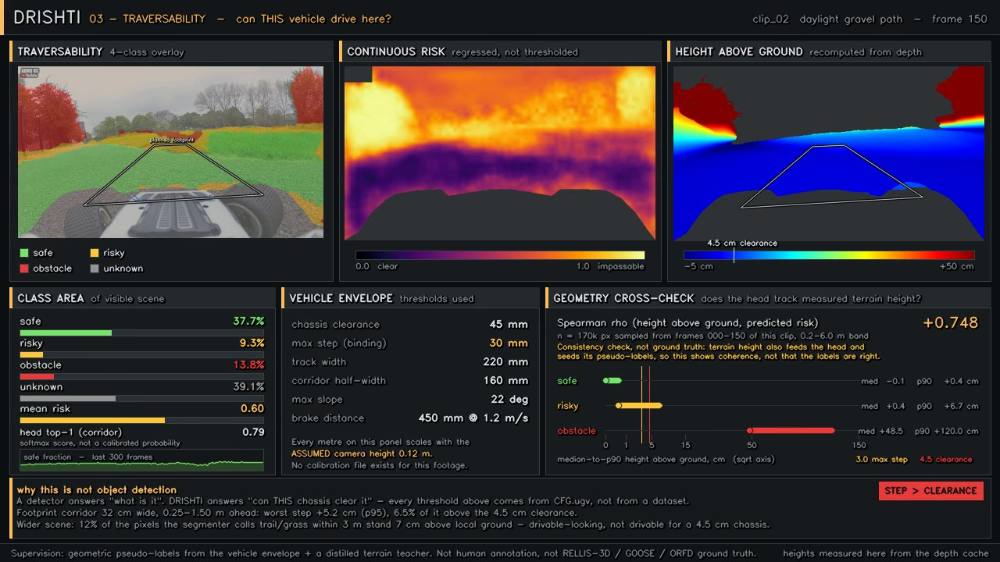
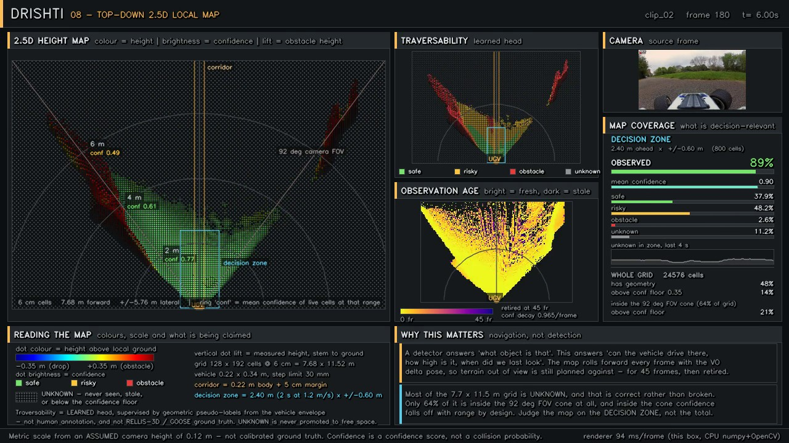
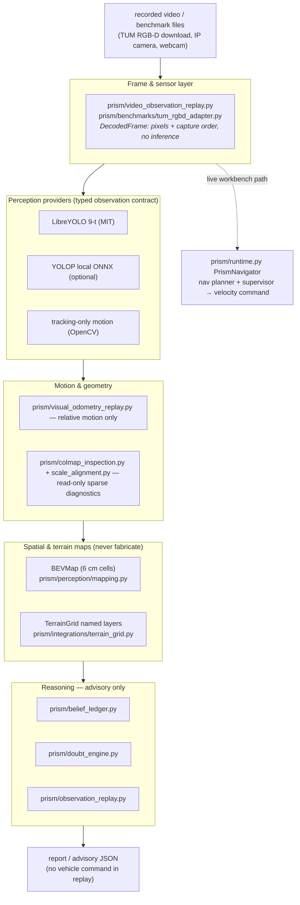

<div align="center">

# P.R.I.S.M.

### **One camera, no GPS — typed evidence, honest uncertainty, and an advisory stack that always shows its work**

*A camera-first autonomy stack for a GPS-denied off-road UGV: typed 2-D evidence,
tracking-only motion, explicit geometry status, a belief ledger, and advice that
never claims more than it measured.*

[](https://www.python.org/)
[](https://pytorch.org/)
[](tests/)
[](ros2/prism_ros/README.md)
[](LICENSE)
[](LICENSE#third-party-components-and-their-repositories)

</div>

---

## 📖 Table of contents

- [What P.R.I.S.M. is](#-what-prism-is)
- [The architecture](#-the-architecture)
- [Run it](#-run-it)
- [What runs where — capability matrix](#-what-runs-where--capability-matrix)
- [Validated numbers (TUM RGB-D)](#-validated-numbers-tum-rgbd)
- [Vehicle profiles as parameters](#-vehicle-profiles-as-parameters)
- [Honesty ledger and limitations](#-honesty-ledger-and-limitations)
- [Repository layout](#-repository-layout)
- [Documentation map](#-documentation-map)
- [Research references](#-research-references)
- [Third-party components and their repositories](#-third-party-components-and-their-repositories)
- [License](#-not-a-mit-license)

---

## 🎯 What P.R.I.S.M. is

P.R.I.S.M. is an **offline-first** perception and advisory system for an unmanned
ground vehicle. From a single RGB camera — no GPS, no LiDAR, no stereo baseline,
no prior map — it produces:

1. **Typed 2-D detection evidence** (LibreYOLO 9-t, MIT checkpoint; optional YOLOP ONNX), validated into a strict observation contract with units, bounds, score semantics and expiry.
2. **Classical image tracking** (OpenCV) with a deterministic IoU tracker fallback (Norfair optional) — motion is tracked, never invented.
3. **Relative visual odometry** plus read-only **COLMAP sparse diagnostics** as a separate landmark artefact — scale stays explicitly unobserved.
4. **A rolling 2.5-D BEV terrain map** (`BEVMap`, 6 cm cells): height `NaN`, traversability `UNKNOWN` until observed and confidence-checked — *unknown never becomes free*.
5. **Layered terrain** (`TerrainGrid`): named layers indexed `[forward, lateral]`, `NaN` where unmeasured, no fabricated variance or normals.
6. **Reasoning**: `BeliefLedger` + `DoubtEngine` produce advisory decisions with explicit evidence expiry and provenance — **advisory only, no vehicle command in replay**.
7. **A live workbench** ([capability matrix](#-what-runs-where--capability-matrix)): the same contract fed from a webcam or IP-camera stream, frame by frame — never a control loop.

> **The one-sentence honesty rule:** any artefact that cannot name the exact
> evidence it used, does not claim that evidence silently.

The stack answers *"can this vehicle drive here, how confident are we, and what
happens if we take this path?"* rather than *"what object is this?"*. It never ends
a frame without a classifiable state, and it never promotes one evidence category
(say, detections) into another (say, terrain accuracy).

<details open>
<summary><b>🎬 See the perception stages run</b> (rendered demo outputs from the pipeline)</summary>

| | |
|---|---|
| **Monocular depth** — Depth Anything V2-Small, relative `q` plus an assumed-scale ground-plane fit<br> | **Terrain segmentation** — prism-7 off-road taxonomy (trail / grass / rough veg / obstacle / water / sky / dynamic)<br> |
| **Traversability** — safe / risky / obstacle / unknown judged against the vehicle profile<br> | **Rolling 2.5-D BEV map** — 6 cm cells; colour is height/risk, unobserved stays UNKNOWN<br> |

</details>

---

## 🏗 The architecture

Boundaries that exist in code (see [`docs/architecture_map.md`](docs/architecture_map.md)):



**Design invariants**

| Seam | Invariant |
|---|---|
| Decode | `DecodedFrame` carries pixels, index, capture order — no perception fields. |
| Provider | `FrameObservationProvider`: `config + __call__` → typed evidence; no control output; no fabrication. |
| Observation | every field typed with units; detections carry taxonomy, score semantics, image bounds, `expires_at_ns`. |
| Runtime adapter | rejects observations that can't safely become a packet (e.g. boxes without geometry); rejects audit never silently coerces. |
| Map (`BEVMap`) | `height=NaN`, `trav=UNKNOWN` for unobserved/stale/low-confidence cells — **unknown is not free**. |
| Reasoning | expiry and "unavailable evidence" are first-class; advisory never commands. |
| Third-party | YOLOP output tensors, COLMAP native units, ROS messages never leak across the seam. |

For the historic navigation runtime (`PrismNavigator`: depth → terrain →
traversability/uncertainty → odometry → map → goal layer → **D\* Lite** → 17 arcs →
**ordered safety supervisor** → `GO / SLOW / REROUTE / STOP`), see
[`docs/ARCHITECTURE.md`](docs/ARCHITECTURE.md).

---

## 🚀 Run it

### 0 · Setup

```bash
git clone https://github.com/White-Reaper0/NavCortex.git
cd NavCortex
pip install -r requirements.txt        # core: numpy, scipy, opencv, torch, transformers, pytest
# optional extras
pip install -r requirements-libreyolo.txt
```

<details>
<summary><b>Windows conda/venv notes</b></summary>

```powershell
python -m venv .venv
.\.venv\Scripts\Activate.ps1
pip install -r requirements.txt
```

</details>

### 1 · Run the test suite (no model weights needed)

```bash
python -m pytest -q tests            # 325 tests, ~3 min
```

### 2 · Run the offline replay (the main entry point)

```bash
python tools/run_prism_integrated_replay.py --clip clips/clip_01.mp4 --output output/prism_integrated_test
```

Processes a bounded 60-frame default into a **fresh, empty** output directory
(the runner refuses to overwrite existing results). It never opens a live camera
and never issues a vehicle action. You get `run_report.json` plus:

```
annotated_replay.mp4   detections.json       tracks.csv
frame_events.jsonl     camera_motion.csv     sparse_geometry_report.json
terrain_report.json    mapping_diagnostic.json
localization_backends.json  advisory_decisions.json
```

### 3 · Install pretrained perception weights (local-only, opt-in)

```bash
python tools/download_prism_pretrained.py          # writes model_assets/pretrained/ + manifest.json
```

- Depth Anything V2-Small — Apache-2.0 card ✔ verified root
- SegFormer-B0/ADE20K — **NVIDIA non-commercial terms**, recorded at link level, **not redistributed**
- Every artifact lands with SHA-256 + size in `model_assets/pretrained/manifest.json`,
  git-ignored, never downloaded by any other entry point (`local_files_only=True`).

### 4 · Live viewer / benchmarks

```bash
# Live viewer workbench (webcam or IP camera; bounded and read-only)
python tools/run_prism_live_viewer.py
# or phone-camera IP stream:
$env:PRISM_IPWEBCAM_URL = "http://<phone-ip>:8080/video"
python tools/run_prism_ipwebcam.py

# TUM RGB-D validation (download, evaluate ATE/RPE, no navigation claim)
python tools/run_prism_dataset_validation.py --sequences xyz --max-frames 80
```

### 5 · Historic navigation runtime (unit-tested decision layer)

```bash
python tools/sim_goal_nav.py                 # closed-loop A→B: 6 scenarios × 3 seeds
python -m prism.runtime                      # module self-test
python -m prism.vehicles                     # list vehicle profiles (rc_pov, wave_rover, example_large_ugv)
```

### 6 · ROS 2 Jazzy + Gazebo Harmonic (written, bring-up not yet run in this repo)

```bash
cd ~/ros2_ws/src && ln -s /path/to/navcortex/ros2/prism_ros .
cd ~/ros2_ws && colcon build --packages-select prism_ros && source install/setup.bash
ros2 launch prism_ros sim.launch.py prism_root:=/path/to/navcortex
```

Details and the rover bring-up: [`ros2/prism_ros/README.md`](ros2/prism_ros/README.md).

---

## 📊 What runs where — capability matrix

Honest, per-capability state (evidence categories kept separate; a pass in one is
never a pass in another). Full inventory: [`docs/live_capability_inventory.md`](docs/live_capability_inventory.md).

| Capability | Where it runs | Status | What it does **not** claim |
|---|---|---|---|
| Frame decode + capture order | `prism/video_observation_replay.py`, `tum_rgbd_adapter.py` | ✅ implemented, unit-tested | no depth/pose inferred by decoding |
| 2-D detection evidence | `prism/libreyolo_provider.py`, `integrations/yolop_provider.py` | ✅ live (bounded) | not detection **accuracy** (unmeasured); YOLOP weights license **UNVERIFIED** |
| Tracking-only motion | `prism/integrations/tracking.py` (deterministic IoU; Norfair optional) | ✅ | not velocity truth |
| Relative VO | `prism/visual_odometry_replay.py` | ✅ | no metric scale |
| Sparse geometry (COLMAP 4.2.1 CPU) | `prism/colmap_inspection.py`, `prism/integrations/geometry.py` | ✅ read-only probe | not a calibrated intrinsic; not redistributed |
| Scale status | `prism/scale_alignment.py` | ✅ separate explicit artifact | monocular scale stays unobservable |
| 2.5-D BEVMap | `prism/perception/mapping.py` | ✅ implemented (validated interfaces) | not traversability **accuracy** |
| Terrain layers | `prism/integrations/terrain_grid.py` | ✅ | unmeasured cells stay `NaN` |
| Belief / doubt advisory | `prism/belief_ledger.py`, `prism/doubt_engine.py` | ✅ | advisory only — never a vehicle command |
| Detection evaluation (vs annotations) | `prism/detection_evaluation.py`, `tools/evaluate_libreyolo.py` | ✅ | the rubric states what was annotated |
| TUM RGB-D validation | `tools/run_prism_dataset_validation.py` | ✅ measured | **not** navigation readiness |
| Live camera workbench | `tools/run_prism_live_viewer.py`, `run_prism_ipwebcam.py` | ✅ bounded | never enters a control loop |
| ONNX export / quantize / prune | `prism/deploy/*` | ✅ scripts, verified | deployment onto new hardware not yet measured |
| ROS 2 node / Gazebo world / rover bridge | `ros2/prism_ros/` | 🟡 written, bring-up pending | wheel to motor JSON format is a firmware **parameter** |

---

## 📐 Validated numbers (TUM RGB-D)

Measured, replicable, and named per metric — see
[`VALIDATION_MILESTONE_SUMMARY.md`](VALIDATION_MILESTONE_SUMMARY.md) and
`output/tum_rgbd_validation_<seq>.json` for the generated report.

| Metric | freiburg1_xyz (80 frames, RGB-only) | Comment |
|---|---|---|
| Tracking success | 96.2 % | no manual corrections |
| ATE position RMSE | 0.0316 m | after Sim(3) alignment; **scale is monocular-unobservable**, so alignment is post-hoc |
| ATE rotation RMSE | 2.185° | drift accumulates with frame count |
| RPE rotation RMSE | 0.483° | alignment-free, frame-count independent |
| Software checks | 8/8 pass · geometric 15/15 pass | report format `prism-tum-rgbd-validation/v2` |

> Every metric is labeled with what was used, on which frames, and which
> evaluation stage. Ground truth is used **only for evaluation**, never fed to VO.

---

## 🚙 Vehicle profiles as parameters

The networks never see the vehicle: depth/terrain/risk output the same numbers,
and drivability is judged afterwards against the profile in `configs/vehicles/`.

| Profile | camera height | clearance | step limit | notes |
|---|---|---|---|---|
| `rc_pov` | 12 cm | 4.5 cm | 3 cm | the RC car in the recorded footage |
| `wave_rover` | 12 cm | 4.5 cm | 3 cm | target rover; 0.6 m/s first-trial cap |
| `example_large_ugv` | 60 cm | 20 cm | 15 cm | *illustrative*: the same 10 cm step that stops the rover is drivable here |

```python
from prism.vehicles import apply_vehicle_profile
apply_vehicle_profile("wave_rover")          # or set PRISM_VEHICLE=wave_rover
```

`tests/test_fit_validity_vehicles.py::test_same_evidence_judged_per_vehicle` pins
that claim: one map with a 10 cm step, two profiles, two verdicts.

---

## 🔍 Honesty ledger and limitations

A strict **planned / running / measured** discipline covers every claim in this repo:

- **Perception evidence is offline.** Every perception number is about the pipeline
  processing recorded footage or downloadable benchmarks. Nothing has been run on a
  physical vehicle in this repository yet.
- **No navigation-ready claim.** The TUM benchmark is VO-tracking validation, not
  autonomy validation. The advisory layer never commands a vehicle.
- **Monocular scale is not observable.** `scale_alignment` produces an explicit,
  separate artefact; RGB-only VO has no metric scale by construction.
- **Metric figures trace to an assumed camera height** (`0.12 m` default in
  `prism/config.py`), and any place it is displayed is labelled as assumed.
- **Trained models are on pseudo-labels**, distilled from an ADE20K teacher on this
  footage — not RELLIS-3D / GOOSE / ORFD ground truth.
- **Simulated metric figures are separated from measured ones.** Every advisory decision
  logs which rule fired and a human-readable reason.
- **COLMAP is an optional external probe**, never redistributed, never linked into
  the runtime (its bundled LSD is AGPL-3.0 — binary must stay external).
- **YOLOP ONNX weights** are SHA-pinned, local-only, git-ignored, license-**UNVERIFIED**;
  no YOLOP source is vendored.
- **Confidence scores are confidence**, not calibrated collision probabilities.
- **Cost/power/industry figures** in the historic presentation material are quoted,
  not measured here.

---

## 📁 Repository layout

```
prism/                     # the library — one Python package
├── config.py, types.py, io_utils.py, viz_common.py   # frozen contract layer
├── runtime.py             # PrismNavigator: camera frame in → command out (live/legacy)
├── observations.py        # Observation + EvidencePayload (typed contract)
├── runtime_adapter.py     # FramePacket + audit, rejects unsafe casts
├── observation_replay.py  # offline, advisory-only replay loop
├── belief_ledger.py       # advisory reasoning: belief, expiry, provenance
├── doubt_engine.py        # doubt classes + expiry handling
├── libreyolo_provider.py  # FrameObservationProvider (LibreYOLO 9-t)
├── detection_evaluation.py
├── calibration.py, colmap_inspection.py, scale_alignment.py
├── models/                # depth, segmentation (PIDNet-S / SegFormer teacher),
│                          # traversability, uncertainty, vpr, world model
├── perception/            # geometry, odometry, imu_fusion, mapping (BEVMap),
│                          # lidarize, cloud_accum, dynamic_layer, fit_validity,
│                          # pose_graph, loop_closure
├── integrations/          # provider_contract, yolop_provider, tracking,
│                          # terrain_grid, terrain, mapping_diagnostic,
│                          # localization, geometry (COLMAP QA)
├── benchmarks/            # tum_rgbd_adapter, trajectory_evaluation, reference_geometry
├── nav/                   # planner (17 arcs), supervisor, goal_planner,
│                          # dstar_lite, goal_map, nav_config, rl_env, train_rl
├── training/              # dataset builders, distillation, run_*_infer caches
├── render/                # one renderer per output stage, built on viz_common
└── deploy/                # ONNX export, pruning, quantization, benchmarking
ros2/prism_ros/            # ROS 2 Jazzy package: prism_node, mission_monitor,
│                          # wave_rover_bridge, Gazebo Harmonic world
configs/vehicles/          # rc_pov, wave_rover, example_large_ugv
tests/                     # ~30 pytest modules (contract + integrations + runtime)
tools/                     # runners: integrated replay, live viewer, ipwebcam,
│                          # dataset validation, model downloads, evaluators, clip cutter
docs/                      # ARCHITECTURE.md, architecture_map.md, provenance docs
model_assets/              # checksum + notice files; heavy *weights* stay git-ignored
clips/                     # demo clip metadata; the .mp4s stay git-ignored for size
context/                   # original speaker packet (PDF)
```

---

## 🗺 Documentation map

| Document | What it covers |
|---|---|
| [`docs/ARCHITECTURE.md`](docs/ARCHITECTURE.md) | the classic navigation stack end to end: frames, cache schemas, training recipes, metric-alignment derivations, rule tables |
| [`docs/architecture_map.md`](docs/architecture_map.md) | seams, contracts and what third-party internals must not leak |
| [`docs/integration_manifest.md`](docs/integration_manifest.md) | which integrations exist, and how they enter |
| [`docs/reuse_strategy.md`](docs/reuse_strategy.md) | which mature algorithms get reused (vs reimplemented) and why |
| [`docs/claims_register.md`](docs/claims_register.md) | every claim, its evidence category, and status |
| [`docs/licenses_and_provenance.md`](docs/licenses_and_provenance.md) | code/weight/dataset licenses, verified list + caveats |
| [`docs/detection_evaluation_workflow.md`](docs/detection_evaluation_workflow.md) | how detector evidence is scored against annotations |
| [`docs/live_viewer_workbench.md`](docs/live_viewer_workbench.md) / [`docs/live_capability_inventory.md`](docs/live_capability_inventory.md) | the live tooling and per-capability status |
| [`docs/ipwebcam_live_testing.md`](docs/ipwebcam_live_testing.md) | phone-IP-camera stream bring-up |
| [`VALIDATION_MILESTONE_SUMMARY.md`](VALIDATION_MILESTONE_SUMMARY.md) | the TUM RGB-D milestone, metric definitions, test additions |
| [`CONTRACT.md`](CONTRACT.md) | the per-module build contract all code was written against |

---

## 📚 Research references

| Stage | Reference | How P.R.I.S.M. uses it |
|---|---|---|
| Depth & scale | Yang et al., *Depth Anything V2*, NeurIPS 2024 ([arXiv:2406.09414](https://arxiv.org/abs/2406.09414)) | pretrained relative depth (local-only weights) |
| Terrain | Xu et al., *PIDNet*, CVPR 2023 ([arXiv:2206.02066](https://arxiv.org/abs/2206.02066)) | PIDNet-S student distilled from a SegFormer-B0 teacher |
| Terrain | Hinton et al., *Distilling the Knowledge…* ([arXiv:1503.02531](https://arxiv.org/abs/1503.02531)) | soft KL distillation to the 7-class off-road taxonomy |
| Traversability | Howard et al., *MobileNetV3*, ICCV 2019 ([arXiv:1905.02244](https://arxiv.org/abs/1905.02244)) | 17-channel traversability head backbone |
| Trust | Gal & Ghahramani, MC Dropout, ICML 2016 ([arXiv:1506.02142](https://arxiv.org/abs/1506.02142)) | 8-dropout-pass trust score |
| Motion | Campos et al., *ORB-SLAM3*, IEEE T-RO ([arXiv:2007.11898](https://arxiv.org/abs/2007.11898)) | front-end style; loop closure + pose graph off the recorded footage |
| Planning | Koenig & Likhachev, *D\* Lite*, AAAI 2002 | incremental replanning to Point B |
| World model | Ha & Schmidhuber, *World Models*, NeurIPS 2018 ([arXiv:1803.10122](https://arxiv.org/abs/1803.10122)) | GRU latent dynamics; suggestion-only |
| RL policy | Schulman et al., *PPO* ([arXiv:1707.06347](https://arxiv.org/abs/1707.06347)) | a supervisor-gated suggestion policy, **never** in the control loop by default |
| Blueprint | Marsal et al., *Offroad-Nav*, ([arXiv:2604.03096](https://arxiv.org/abs/2604.03096)) | the broader mono-camera navigation blueprint |

---

## 🤝 Third-party components and their repositories

P.R.I.S.M.'s own code is **not** MIT — see [License](#-not-a-mit-license). The
third-party components it builds on *are* individually licensed by their
respective projects; their repositories and terms are:

| Repository | Version / artifact | License in that repo | How P.R.I.S.M. uses it |
|---|---|---|---|
| [OpenCV](https://github.com/opencv/opencv) (`opencv-python`) | ≥ 4.8 | Apache-2.0 | decode, ORB, DNN ONNX runtime, window display |
| [PyTorch](https://github.com/pytorch/pytorch) / [TorchVision](https://github.com/pytorch/vision) | ≥ 2.2 | BSD-3-Clause | inference, training, MobileNetV3 backbone |
| [NumPy](https://github.com/numpy/numpy) / [SciPy](https://github.com/scipy/scipy) | 1.26 / 1.15 | BSD-3-Clause | numerics |
| [Transformers](https://github.com/huggingface/transformers) | ≥ 4.40, < 5 | Apache-2.0 | loading pretrained local weights, `local_files_only=True` |
| [huggingface_hub](https://github.com/huggingface/huggingface_hub) | 0.36 | Apache-2.0 | only `tools/download_prism_pretrained.py` reaches the network |
| [ONNX Runtime](https://github.com/microsoft/onnxruntime) | ≥ 1.17 | MIT | inference only |
| [Open3D](https://github.com/isl-org/Open3D) | 0.20 | MIT | optional viewer for sparse/point-cloud output |
| [Norfair](https://github.com/tryolabs/norfair) | 2.3 | BSD-3-Clause | optional tracker (deterministic IoU is the default) |
| [LibreYOLO](https://github.com/LibreYOLO/libreyolo) | 1.6.0 | MIT (code) · [LibreYOLO9t checkpoint](https://huggingface.co/LibreYOLO/LibreYOLO9t) MIT | the 2-D detector (SHA-pinned, notice files in `model_assets/libreyolo/`) |
| [YOLOP](https://github.com/hustvl/YOLOP) | local ONNX only | MIT repo file (weights **UNVERIFIED**; chain-of-title caveat) | optional provider, never vendored, git-ignored |
| [COLMAP](https://github.com/colmap/colmap) | 4.2.1 CPU | BSD-3-Clause upstream; bundled LSD component AGPL-3.0 | local, read-only sparse probe — **binary never redistributed** |
| [Depth Anything V2-Small](https://huggingface.co/depth-anything/Depth-Anything-V2-Small-hf) | pinned rev | Apache-2.0 card | relative depth; local weights only |
| [SegFormer B0-ADE20K](https://huggingface.co/nvidia/segformer-b0-finetuned-ade-512-512) / [NVIDIA SegFormer](https://github.com/NVlabs/SegFormer) | pinned rev | **NVIDIA non-commercial** verification | teacher for terrain distillation; local-only, never redistributed |
| [TUM RGB-D benchmark](https://vision.in.tum.de/data/datasets/rgbd-dataset) (Technical University of Munich) / [TUM RGB-D tooling](https://github.com/tum-vision) | freiburg1_* | CC-BY-4.0 data · BSD-2-Clause code | validation trajectory inputs; not redistributed |
| [grid_map](https://github.com/ANYbotics/grid_map), [elevation_mapping](https://github.com/leggedrobotics/elevation_mapping), [traversability_estimation](https://github.com/leggedrobotics/traversability_estimation) (ETH/RSL) & [Basalt](https://github.com/VladyslavUsenko/basalt), [RTAB-Map](https://github.com/introlab/rtabmap), [stella_vslam](https://github.com/stella-cv/stella_vslam) | concepts only | BSD-2/3-Clause | concept reuse; **no source copied** into P.R.I.S.M. |
| [Stable-Baselines3](https://github.com/DLR-RM/stable-baselines3) | ≥ 2.2 | MIT | historic PPO suggestion-policy training |
| [GTSAM](https://github.com/borglab/gtsam) (optional) | ≥ 4.2 | BSD-3-Clause | optional pose-graph backend (built-in fallback solver ships) |
| [ROS 2](https://github.com/ros2) Jazzy / [Gazebo](https://github.com/gazebosim/gz-sim) Harmonic | Jazzy / Harmonic | Apache-2.0 / Apache-2.0 | optional deployment targets |

Full, verified list with scoping rules and caveats:
[`docs/licenses_and_provenance.md`](docs/licenses_and_provenance.md) ·
LibreYOLO-specific notices in [`model_assets/libreyolo/THIRD_PARTY_NOTICES.md`](model_assets/libreyolo/THIRD_PARTY_NOTICES.md)
and [`model_assets/libreyolo/NOTICE.md`](model_assets/libreyolo/NOTICE.md).

---

## 📄 **NOT a MIT license**

P.R.I.S.M.'s own code, configuration, documentation and model-derived artifacts are
**not released under MIT** (nor any open-source license). They are
**All Rights Reserved** — use, copying, modification, and distribution require
prior written authorization. See [`LICENSE`](LICENSE).

All third-party repositories listed above keep their own licenses, which remain in
force on their respective components and are attributed in the
**Third-party components and their repositories** section of `LICENSE` — but no
third-party license (including MIT) is granted to, or extends to, P.R.I.S.M.'s own
code.

---

<div align="center">

**P.R.I.S.M.** · Team UniMinds · *one camera, and advice that always shows its evidence.*

</div>
